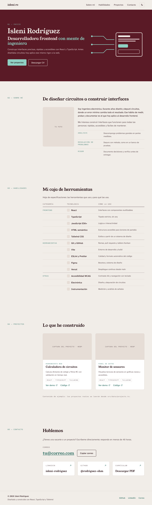
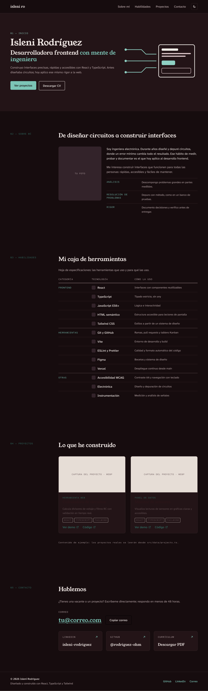
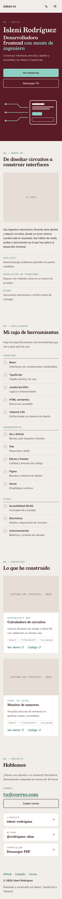

# Design System

Sistema visual del portafolio: colores, tipografía, espaciado y retícula.
Los criterios que justifican estas decisiones están en `design-brief.md`.

## Paleta: Pátina

Inspirada en el cobre oxidado (verdigris) junto a un rojo profundo,
sobre piedra cálida. Nivel de intensidad 2: un bloque de color
protagonista en el Hero y el resto del sitio sobrio.

| Rol                           | Modo claro | Modo oscuro | Uso                                 |
| ----------------------------- | ---------- | ----------- | ----------------------------------- |
| Fondo                         | `#f1ede8`  | `#160c0e`   | Base de toda la página              |
| Superficie                    | `#ffffff`  | `#231417`   | Tarjetas                            |
| Texto principal               | `#2a1418`  | `#f1e9e6`   | Títulos y texto importante          |
| Texto secundario              | `#5e4c4f`  | `#b9a7a9`   | Descripciones y apoyo               |
| Acento                        | `#2f6f64`  | `#7cc4b6`   | Enlaces, etiquetas, foco            |
| Texto sobre acento            | `#ffffff`  | `#160c0e`   | Texto dentro de botones             |
| Bloque de marca               | `#5a1a26`  | `#231417`   | Fondo del Hero                      |
| Texto sobre bloque            | `#f1ede8`  | `#f1e9e6`   | Títulos dentro del Hero             |
| Texto secundario sobre bloque | `#dcc6c9`  | `#b9a7a9`   | Frase de valor del Hero             |
| Acento sobre bloque           | `#8fd0c3`  | `#7cc4b6`   | Detalles y botón principal del Hero |
| Borde                         | `#d9cfc9`  | `#3a2a2d`   | Separadores y tarjetas (decorativo) |
| Borde fuerte                  | `#8c7b7d`  | `#7d6a6c`   | Botones con borde y controles (3:1) |

### Contraste (WCAG AA)

Mínimos: 4.5:1 para texto normal y 3:1 para texto grande y
componentes de interfaz. Todas las combinaciones cumplen AA.

| Combinación                            | Claro | Oscuro |
| -------------------------------------- | ----- | ------ |
| Texto principal sobre fondo            | 14.9  | 16.1   |
| Texto secundario sobre fondo           | 6.9   | 8.4    |
| Acento sobre fondo                     | 5.0   | 9.5    |
| Texto sobre botón de acento            | 5.9   | 9.5    |
| Texto sobre bloque de marca            | 11.2  | 14.8   |
| Texto secundario sobre bloque de marca | 8.1   | 7.7    |
| Acento sobre bloque de marca           | 7.4   | 8.8    |
| Borde fuerte sobre fondo               | 3.4   | 3.8    |

Reglas:

- El acento en modo claro (`#2f6f64`) tiene poco margen: no aclararlo.
- `#8fd0c3` solo se usa sobre el bloque de marca, nunca sobre el fondo claro.
- El borde decorativo no se usa en controles interactivos: ahí va el borde fuerte.

## Tipografía: Legibilidad

| Rol                     | Fuente                     | Pesos       |
| ----------------------- | -------------------------- | ----------- |
| Títulos                 | Young Serif                | 400 (único) |
| Texto                   | Atkinson Hyperlegible Next | 400 y 500   |
| Etiquetas y tecnologías | Atkinson Hyperlegible Mono | 400         |

Atkinson Hyperlegible fue diseñada por el Braille Institute para
personas con baja visión: refuerza la promesa de interfaces accesibles.

## Escala tipográfica

Escala modular: tamaño = base × razón^n

- Móvil: base 16 px, razón 1.2
- Escritorio: base 18 px, razón 1.25

| Rol               | Paso | Móvil | Escritorio | Interlineado |
| ----------------- | ---- | ----- | ---------- | ------------ |
| Título del Hero   | 5    | 40 px | 55 px      | 1.1          |
| Título de sección | 3    | 28 px | 35 px      | 1.15         |
| Título de tarjeta | 1    | 19 px | 22 px      | 1.2          |
| Texto normal      | 0    | 16 px | 18 px      | 1.6          |
| Etiquetas         | −1   | 13 px | 14 px      | 1.4          |

## Reglas de uso

- Títulos grandes con interletrado ligeramente negativo (−0.01em).
- Etiquetas en mayúsculas con interletrado positivo (0.08em).
- Párrafos de 60 a 75 caracteres por línea.
- Un solo botón con relleno de acento por vista; el secundario lleva solo borde.

## Espaciado

Unidad base de 4 px (la misma de Tailwind). Regla: cuanto más
relacionados están dos elementos, menos espacio hay entre ellos.

| Nivel      | Valores                         | Uso                                      |
| ---------- | ------------------------------- | ---------------------------------------- |
| Íntimo     | 4 – 8 px                        | Dentro de un grupo: etiqueta y título    |
| Componente | 12 – 24 px                      | Relleno de tarjetas y botones            |
| Bloque     | 32 – 48 px                      | Entre tarjetas, entre título y contenido |
| Sección    | 64 px móvil · 128 px escritorio | Entre secciones                          |

## Retícula

| Pantalla             | Columnas | Medianil | Márgenes    | Ancho máximo |
| -------------------- | -------- | -------- | ----------- | ------------ |
| Móvil (375 px)       | 4        | 16 px    | 20 px       | —            |
| Tablet (768 px)      | 8        | 24 px    | 32 px       | —            |
| Escritorio (1280 px) | 12       | 32 px    | automáticos | 1152 px      |

- Secciones en escritorio con estructura de ficha técnica:
  etiqueta en las columnas 1–3 y contenido en las 4–12.
- El Hero es la excepción: texto en las columnas 1–6 y gráfico
  "del circuito a la interfaz" en las 7–12. Se pasó de 7/5 a 6/6 al
  programarlo, para equilibrar el peso visual del nombre y el gráfico.

## Decisiones por sección

- **Habilidades:** tabla tipo hoja de especificaciones con las columnas
  Categoría, Tecnología y Cómo la uso. Sin barras de nivel.
- **Contacto:** sin formulario. Correo destacado con botón para copiarlo
  y enlaces a LinkedIn, GitHub y el CV.

## Diseños

Archivo en Figma: [Portafolio — Diseño (Fase 2)](https://www.figma.com/design/2FVjbzt4JaFCLQi4fdZHyk)

### Escritorio · modo claro

### Escritorio · modo oscuro

### Móvil · modo claro

